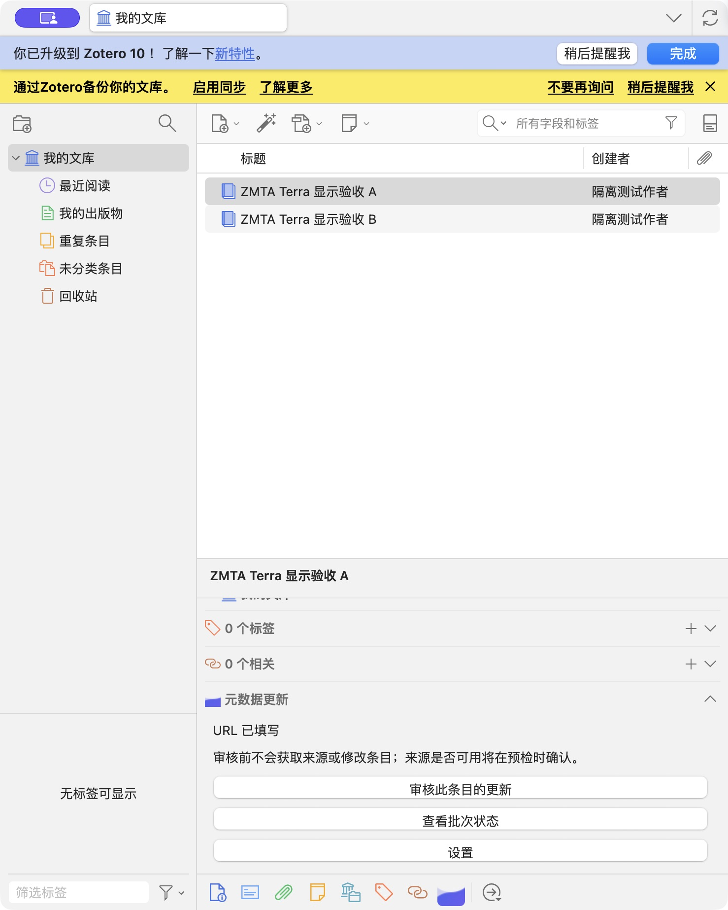
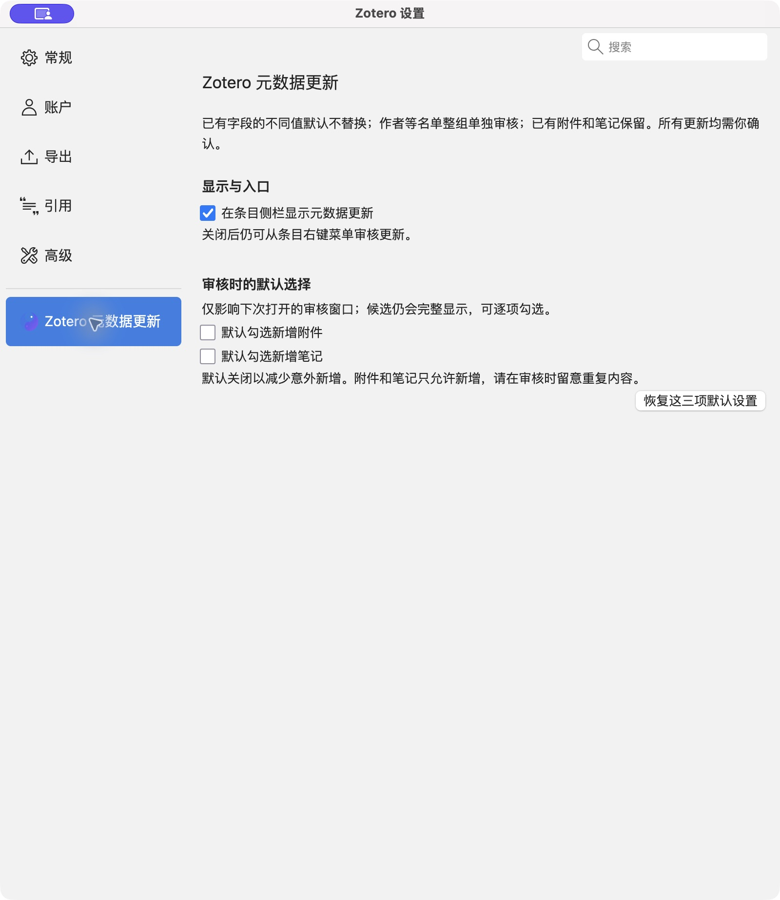

<p align="center">
  
</p>

<h1 align="center">Zotero 元数据更新</h1>

<p align="center">重新获取条目信息，先看差异，再决定改什么。</p>

<p align="center">
  
  
  
  
</p>

<p align="center">
  <a href="#功能">功能</a> ·
  <a href="#当前支持的元数据更新">支持范围</a> ·
  <a href="#界面">界面</a> ·
  <a href="#安装">安装</a> ·
  <a href="#使用">使用</a> ·
  <a href="#常见问题">FAQ</a> ·
  <a href="#技术栈与依赖">技术栈</a> ·
  <a href="#本地开发">本地开发</a> ·
  <a href="#反馈与许可">反馈与许可</a>
</p>

用条目已有的 **URL 或 DOI** 重新查一次，把新拿到的信息和本地内容并排摆在一起。你勾哪一项，它才改哪一项；不勾的，原样留着。

## 功能

- **先对照，再更新**：新旧信息逐项列出，有分歧的字段默认不动，由你决定。
- **单条顺手改，批量慢慢审**：侧栏可直接审核当前条目；右键最多选 50 个条目一起过。
- **作者名单整组审核**：作者、编辑、译者按整组确认，不会只换名字却留下旧顺序。
- **附件和笔记只增不改**：已有内容不碰，新增默认不勾选。
- **结果可查、可重试、可撤销**：查看最近一次更新的结果，重试失败项，条件允许时撤销。

## 当前支持的元数据更新

以下为 **0.5.1** 的已实现范围。插件更新的是文库中已有的书目条目，数据来自 Zotero 当前可用的转换器；具体能取到哪些字段，取决于来源实际返回的内容。

### 支持的来源与查找方式

| 来源或标识 | 当前支持 | 使用条件与边界 |
| --- | --- | --- |
| 豆瓣图书 URL | 按原豆瓣图书页面获取最新图书信息 | 条目类型为图书，URL 为 `https://book.douban.com/subject/…/`；结果须与原豆瓣图书编号一致，依赖可用的豆瓣转换器 |
| DOI | 使用 Zotero 的 DOI 搜索转换器获取元数据 | 条目的 DOI 字段有有效 DOI；来源须返回相同 DOI，且条目类型等身份信息通过核对 |
| 其他 HTTP(S) URL | 使用 Zotero 的网页转换器获取元数据 | 网址有匹配的转换器，来源结果通过身份核对；并非任意网页都支持 |

普通更新优先读取条目 URL；未获得可用结果且有有效 DOI 时，在允许的情况下再尝试 DOI，也可通过菜单选择“用 DOI 查找…”。标识符或条目类型冲突等情况会阻断更新。

**仅有 ISBN、arXiv 号或 PMID 时，当前没有独立的编号检索入口。** 如果条目同时有受支持的 URL 或有效 DOI，仍可按上表的方式获取信息。ISBN 可用于核对来源是否为同一本书，不等同于已支持按 ISBN 检索。

### 可以审核和更新哪些内容

| 内容 | 常见更新项 | 更新方式 |
| --- | --- | --- |
| 书目字段 | 标题、短标题、摘要、日期、语言、网址等 | 只展示来源返回且适用于当前条目类型的差异；空白字段默认勾选，替换已有值需主动勾选 |
| 图书字段 | 出版社、出版地、ISBN、总页数、丛书、版次等 | 以图书来源实际返回的字段为准，不保证每个来源都有全部字段 |
| 论文等条目的字段 | 期刊或出版物名称、卷、期、页码、DOI、ISSN 等 | 以 DOI／网页转换器实际返回且适用于该条目类型的字段为准 |
| 作者与贡献者 | 作者、编辑、译者等名单及顺序 | 按完整名单整组审核；已有名单默认保留 |
| 附件 | 转换器返回的附件候选 | 确认后仅新增；不修改或删除已有附件，也不保证每个来源都能提供可下载附件 |
| 笔记 | 转换器返回的笔记内容 | 确认后仅新增；不修改或删除已有笔记，不自行生成笔记 |

所有勾选都只是审核选择，点击“更新所选内容”后才写入。插件不根据标题搜索文献、不从本地 PDF 全文提取元数据、不新建书目条目或改变条目类型；不更新标签、分类或 `extra` 字段。附件与笔记不自动去重。

## 界面

截图来自 Zotero 10，使用演示条目。点击图片可查看大图。

<table>
  <tr>
    <th>条目侧栏</th>
    <th>插件设置</th>
  </tr>
  <tr>
    <td valign="top"><a href="docs/images/item-pane.jpg"></a></td>
    <td valign="top"><a href="docs/images/preferences.jpg"></a></td>
  </tr>
</table>

## 安装

需要 **Zotero 10 桌面版**，目前主要在 macOS 上使用。

> **当前正式版：[0.5.1](https://github.com/iiwenwen/zotero-update-metadata/releases/latest)**。下载 `zotero-update-metadata.xpi` 安装。此版使用独立插件 ID；从旧 1.x 或测试版切换时需手动安装，并先禁用或移除测试版，避免两个版本同时运行。

1. 打开 Zotero，进入 **工具 → 插件**。
2. 点齿轮菜单，选 **从文件安装插件**。
3. 选中 `.xpi`，按提示完成安装。

装之前备份文库，先用少量条目试用——撤销不能代替备份。

### 后续更新

安装正式版后，由 Zotero 内置插件管理器检查和安装后续正式更新；也可在 **工具 → 插件** 的齿轮菜单中手动检查更新。使用同一正式 ID 的 `0.4.1`、`0.4.2` 可更新到 `0.5.1`。旧 1.x 和 `@local` 测试版不会跨 ID 自动迁移，首次切换仍需手动安装。插件详情中的主页指向本仓库，问题请到 [Issues](https://github.com/iiwenwen/zotero-update-metadata/issues) 反馈。

## 使用

1. 选中要更新的可编辑书目条目。
2. 右键选 **元数据更新 → 查找可更新内容…**；单条也可点侧栏的 **查找可更新内容**。
3. 对照新旧信息，勾选你认可的内容。
4. 点 **更新所选内容**，查看结果。取消审核不会修改条目。

条目需要有可用的 URL 或 DOI，能否取到取决于目标网站和 Zotero 的支持；豆瓣等站点可能限流，被拒时别连着重试。

### 默认设置

| 设置 | 默认 | 作用 |
| --- | --- | --- |
| 在条目侧栏显示更新入口 | 开启 | 显示单条入口；关闭后仍可用右键菜单 |
| 默认勾选新增附件 | 关闭 | 下次审核时是否预选附件 |
| 默认勾选新增笔记 | 关闭 | 下次审核时是否预选笔记 |

改动只影响之后打开的审核窗口。

### 改动前注意

- 已有字段有不同值时默认不替换，需你主动勾选。
- 作者名单整组替换，确认前看一眼成员和顺序。
- 已有附件和笔记不会被修改或删除；新增内容不去重，留意重复。
- 撤销只针对最近一次更新，且只回退能确认归属的改动。

## 常见问题

**为什么有差异的字段默认不勾选？** 本地值可能是你手改过的，插件不知道谁对，决定权留给你。

**取不到信息怎么办？** 先按[支持范围](#当前支持的元数据更新)确认条目有受支持的 URL 或有效 DOI；仅有 ISBN、arXiv 号或 PMID 不会触发对应编号检索。站点改版、限流或转换器不可用也可能导致获取失败。

**会动已有的附件和笔记吗？** 不会，只允许新增，但不会自动去重。

**支持 Zotero 7/8/9 或移动端吗？** 不支持，只针对 Zotero 10 桌面版。

## 技术栈与依赖

**技术栈**：TypeScript 直接调用 Zotero 原生扩展 API，界面用 XHTML/XUL + DOM API 复用 Zotero 控件，不引入前端框架；多语言用 Fluent（`.ftl`），构建打包用 zotero-plugin-scaffold + esbuild，测试用 Mocha + Chai。

**用到的第三方仓库**（版本以 `package-lock.json` 为准）：

| 仓库 | 版本 | 用途 |
| --- | --- | --- |
| [zotero-plugin-toolkit](https://github.com/windingwind/zotero-plugin-toolkit) | 5.2.0 | 运行时工具库（对话框等），唯一随插件打包的第三方代码 |
| [zotero-plugin-scaffold](https://github.com/northword/zotero-plugin-scaffold) | 0.8.8 | 开发服务、热重载、构建与 XPI 打包 |
| [esbuild](https://github.com/evanw/esbuild) | 0.28.2 | 打包插件源码与测试 bundle |
| [zotero-types](https://github.com/windingwind/zotero-types) | 4.1.3 | Zotero API 类型定义 |
| [Mocha](https://github.com/mochajs/mocha) | 11.8.0 | 测试运行器 |
| [Chai](https://github.com/chaijs/chai) | 6.2.2 | 断言库 |
| [@types/mocha](https://github.com/DefinitelyTyped/DefinitelyTyped) / [@types/chai](https://github.com/DefinitelyTyped/DefinitelyTyped) | 10.0.10 / 5.2.3 | 类型声明 |

间接依赖与许可见 [package-lock.json](package-lock.json) 和[第三方说明](addon/content/third-party-notices.txt)。

## 本地开发

需要 Node.js 24、Git；检查脚本还需要 Python 3.9+。

```bash
git clone https://github.com/iiwenwen/zotero-update-metadata.git
cd zotero-update-metadata
npm ci
npm run build
```

构建产物在 `.scaffold/build/`，生成的 `.xpi` 可直接装进 Zotero。

| 命令 | 说明 |
| --- | --- |
| `npm start` | 开发服务，默认模拟获取结果，需要本地 Zotero 环境配置 |
| `npm run start:live` | 使用真实来源获取信息 |
| `npm run test:core` | 离线核心测试 |
| `npm run test:ui` | 离线界面与工作流测试 |
| `npm run check` | 构建并检查基本安全规则 |

开发配置与数据保护要求见 [CONTRIBUTING.md](CONTRIBUTING.md)，维护者推送源码后运行 `npm run release` 即可发版，详见 [RELEASING.md](RELEASING.md)。

## 反馈与许可

问题或建议请开 [Issue](https://github.com/iiwenwen/zotero-update-metadata/issues)，附上 Zotero 版本、插件版本、操作步骤和报错截图，并遮盖私人信息；不要上传整库数据或完整更新日志。版本变化见 [CHANGELOG.md](CHANGELOG.md)。

插件不带遥测，也不上传文库；查询时会向目标网站发送 URL、DOI 等必要信息，更新日志存在本地，可能含文献信息，请自行保管。

**许可证**：本重写版的项目许可尚未确定（`UNLICENSED`），尚未授予他人修改或再分发的许可；第三方依赖保留各自许可。
